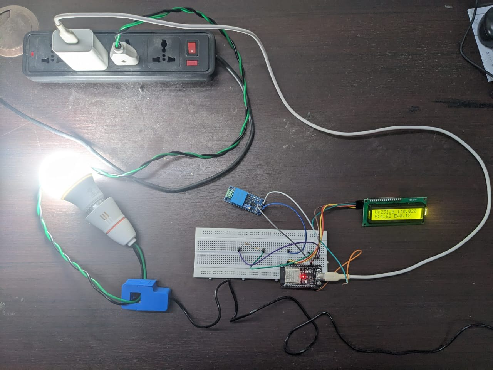
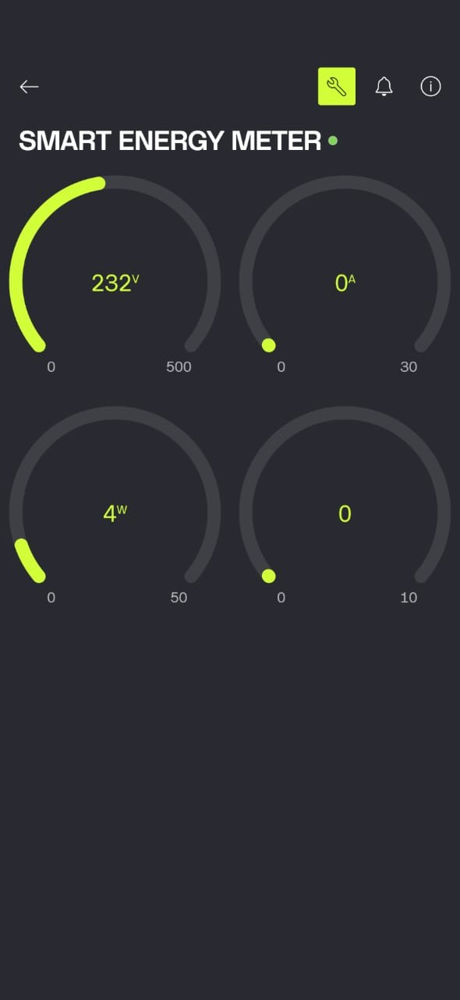
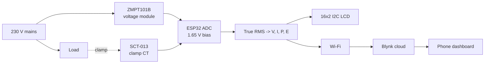
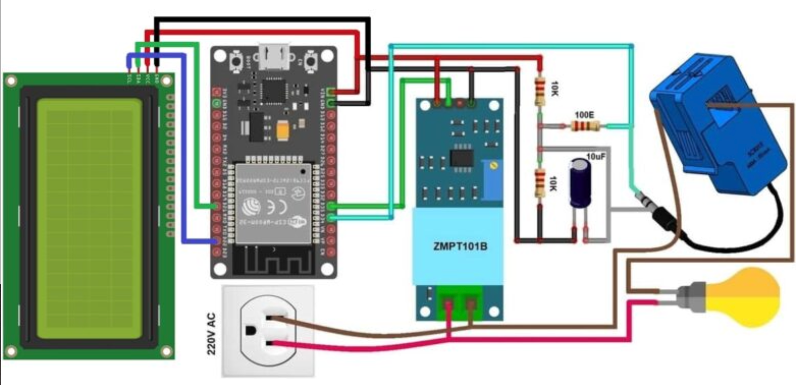
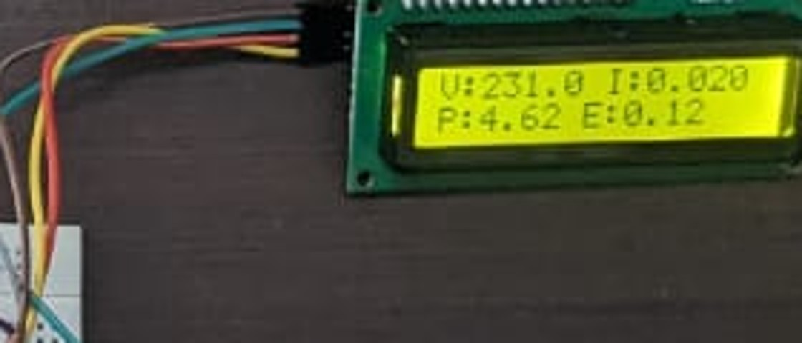
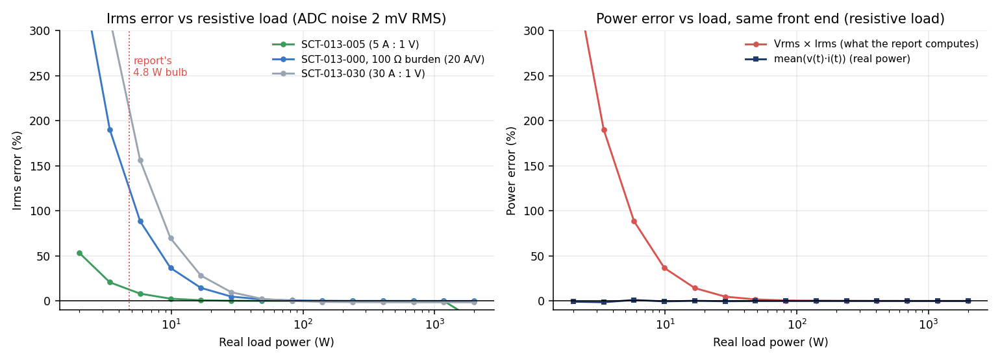

# IoT Smart Energy Meter

**A low-cost ESP32 energy meter that measures mains voltage, current, power and accumulated energy with isolated sensors, shows them on a local LCD, and streams them to a Blynk phone dashboard. Includes a tested reference model of the measurement maths and a study of how far this front end can be trusted at light loads.**

[](https://github.com/lohitashva2004-netizen/iot-smart-energy-meter/actions)


Mini project for *21ECC301P: MMIT*, B.Tech ECE (Data Science specialisation), SRM Institute of Science and Technology, Vadapalani, November 2025. Faculty guide: Dr. Priti Rishi.

<p align="center">
  
  
</p>

> ⚠️ **This device connects to mains voltage.** Read [the safety notes](docs/hardware.md#safety) before building anything.

---

## Why

Traditional meters only show a running total, so consumers can't see what an appliance draws right now. Commercial smart meters exist, but cheap retrofit options with both a **local display** and a **cloud dashboard** are scarce. This project builds one from off-the-shelf parts, with safety (galvanic isolation, non-invasive current sensing) and transparency (open firmware, documented calibration) as the main design goals.

## What it does

- Measures **voltage, current, power and energy** for a single-phase 230 V / 50 Hz load.
- **Isolated sensing:** a ZMPT101B transformer module for voltage and a clamp-on SCT-013 CT for current, so there is no electrical connection from the mains to the microcontroller and no wire cutting.
- **True-RMS maths:** the ESP32 samples both channels for 10 whole mains cycles (200 ms), removes the ADC bias and takes the root of the mean square, which also holds for non-sinusoidal loads.
- **Two interfaces:** a 16×2 I²C LCD on the device, and a Blynk dashboard (gauges, values, power history) on any phone.
- **Keeps working offline:** the LCD and energy counter continue if Wi-Fi or the cloud drops; Blynk reconnects in the background.
- **Survives power cuts:** accumulated energy is saved to flash every 10 minutes.
- **Calibrates from the serial monitor** (`cv`, `ci`, `zero`, `reset`, `show`) against a multimeter and stores the result.

## Architecture





Hardware details, pin map and design notes: [docs/hardware.md](docs/hardware.md).

## Results from the prototype

Test load: a lamp of a few watts, with a calibrated multimeter as the voltage reference. These are the figures reported in the project:

| Quantity | Observation |
|---|---|
| Voltage | Stable at **229–230 V**; the multimeter read **229.5 V** |
| Power | Settled around **4.8 W** for the test load (the LCD photo shows 4.62 W) |
| Energy | Incremented continuously while the load ran |
| Local + remote | LCD and Blynk updated together every 2 s |



The LCD reads `V:231.0 I:0.020` / `P:4.62 E:0.12`, which is exactly 231.0 V × 0.020 A. Note that this is *apparent* power, and see the first limitation below. The energy figure is in Wh. Details in [docs/notes_on_course_report.md](docs/notes_on_course_report.md).

## A closer look: how low can the front end go?

The repo includes a **reference model** of the measurement chain (`src/energy_meter`): mains waveforms → CT and ZMPT front ends → bias, noise and 12-bit quantisation → the same RMS maths as the firmware. It is used by the tests and by a measurement study.



| True load | Vrms × Irms error (SCT-013-000, 100 Ω) | mean(v·i) real-power error |
|---|---|---|
| 5 W | +110% | +0.6% |
| 10 W | +36% | -0.2% |
| 50 W | +2% | -0.1% |
| 100 W | +0% | +0.0% |

*(Model with an assumed 2 mV RMS ADC noise, not measured data. Full table and caveats: [docs/measurement_study.md](docs/measurement_study.md).)*

What it suggests:

1. At a ~5 W load the CT signal is about one ADC step, so noise dominates the **RMS current** estimate, while multiplying instantaneous voltage and current (**real power**) averages the noise away and stays accurate.
2. From roughly 50 W upward the simple V × I approach is accurate to about 2%.
3. Real power also yields power factor, which V × I cannot. That is the "Power Factor and Real Power" item in the project's future scope, and the model says it is the most valuable accuracy upgrade.

## Quick start

### Build the hardware

1. Wire it as in [docs/hardware.md](docs/hardware.md) (**supply disconnected**).
2. Copy `firmware/smart_energy_meter/secrets.example.h` to `secrets.h` and fill in Wi-Fi and Blynk credentials. [Blynk setup](docs/blynk_setup.md).
3. Check `firmware/smart_energy_meter/config.h` (pins, CT type) and flash with the Arduino IDE (board *ESP32 Dev Module*; libraries *Blynk* and *LiquidCrystal I2C*).
4. Calibrate from the Serial Monitor (115200 baud): see [docs/calibration.md](docs/calibration.md).

### Run the model and tests (no hardware needed)

```bash
git clone https://github.com/lohitashva2004-netizen/iot-smart-energy-meter.git
cd iot-smart-energy-meter
pip install -e ".[dev]"

pytest -q                                              # 34 tests
python scripts/simulate_meter.py --load-w 100 --pf 0.9 # watch a simulated meter run
python scripts/make_figures.py                         # regenerate figures + docs/measurement_study.md
```

## Repository layout

```
├── firmware/smart_energy_meter/
│   ├── smart_energy_meter.ino    ESP32 sketch
│   ├── config.h                  pins, CT type, timing
│   └── secrets.example.h         Wi-Fi + Blynk credentials template (copy to secrets.h)
├── src/energy_meter/             reference model
│   ├── dsp.py                    true RMS, apparent / real power, power factor
│   ├── calibration.py            CT scaling, calibration helpers, noise-floor removal
│   ├── energy.py                 energy accumulator
│   └── waveforms.py, simulate.py mains + ADC front-end model
├── scripts/                      simulate_meter.py, make_figures.py
├── tests/                        34 unit tests
└── docs/                         hardware, calibration, Blynk setup, measurement study, notes
```

## Limitations

- **Apparent, not real, power.** The meter computes P = V × I, which equals real power only for a resistive load. Lamps with switch-mode drivers (such as LED bulbs) and motors have a power factor below 1, so the power and energy shown are overstated for them. A "kWh" from this design is apparent energy unless real-power measurement is added.
- **Light-load resolution.** Around 5 W the current signal is at the ADC's resolution floor with a 100 A-class CT. Verify with a larger known load, and pick a CT range that matches your loads.
- **Not revenue-grade.** There is no certified metrology, temperature compensation or anti-tamper design.
- **Single phase, breadboard build.** No three-phase support; the prototype is a bench build, not an enclosed product.
- **Firmware not validated on hardware here.** The sketch was written from the project description and has been syntax-checked against stub headers; the measurement maths is validated in the Python model. Calibrate and verify on your own hardware before relying on any reading.
- **Security.** Default Blynk connection is on port 80; see [docs/blynk_setup.md](docs/blynk_setup.md).

## Roadmap

- [ ] Real power and power factor on the ESP32 (cross-correlation of v and i, with phase-offset correction)
- [ ] Remote on/off with a relay driven from Blynk
- [ ] Micro-SD logging with sync after outages
- [ ] Over/under-voltage alerts as push notifications
- [ ] Custom PCB and an insulated 3D-printed enclosure
- [ ] Validate against a calibrated power analyser across 5 W to 2 kW

## Related work reviewed in the project report

- *IoT-Based Smart Energy Metre And Monitoring System*, J. Sci. Res. Technol., 2021.
- *Using IoT for Overvoltage/Undervoltage Detection*, Scientific Engineering International Journal, 2021.
- *An IoT Based Real-time Low Cost Smart Energy Meter*, arXiv, 2020.
- *A New IoT-Based Smart Energy Meter for Smart Grids*, Int. J. Energy Research, 2020.
- *Smart Energy Meters for Smart Grids, an Internet of Things Perspective*, Energies, 2023.

## Team

- Lohitashva V S
- Jayaprakash L
- Prabhanjan G H

**Faculty guide:** Dr. Priti Rishi, Associate Professor, Dept. of ECE, SRM IST Vadapalani

## License

MIT, see [LICENSE](LICENSE). Mains-voltage hardware: build and use at your own risk.
