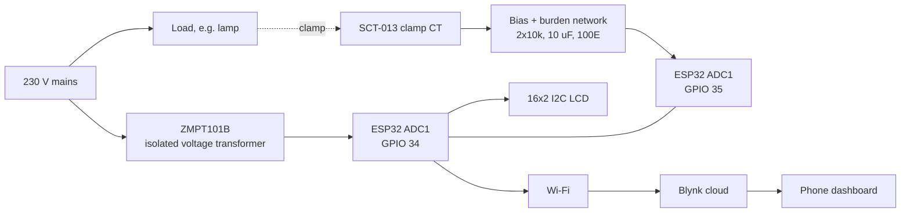
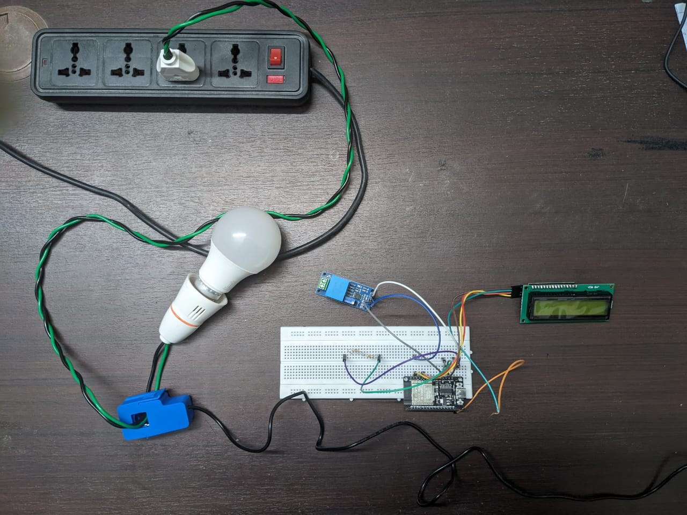

# Hardware

## Signal chain

## Components

| Component | Role |
|---|---|
| NodeMCU ESP32 | Dual-core 32-bit MCU with Wi-Fi: samples both channels, computes RMS/power/energy, drives the LCD, talks to Blynk |
| ZMPT101B module | Galvanically isolated voltage transformer: steps mains down to a small AC signal proportional to line voltage |
| SCT-013 clamp CT | Non-invasive current sensor: clamps around the live wire, no cutting or splicing |
| 2 × 10 kΩ, 10 µF | Bias network: divider makes a 1.65 V mid-rail, the capacitor couples the AC signal onto it so the waveform stays inside the 0–3.3 V ADC range |
| Burden resistor (100 Ω in the diagram) | Turns a current-output CT's secondary current into a voltage |
| 16×2 LCD with I²C backpack | Local readout on 4 wires (VCC, GND, SDA, SCL) |

Mains-connected load: a bulb in a holder, fed from a power strip. The report's bill of materials is not itemised with prices, so none are quoted here.

## Pin map used by the firmware

| Signal | GPIO | Notes |
|---|---|---|
| Voltage (ZMPT101B out) | 34 | ADC1, input-only |
| Current (CT network out) | 35 | ADC1, input-only |
| LCD SDA / SCL | 21 / 22 | I²C, address 0x27 (0x3F on some backpacks) |

> **Verify against your wiring.** The project report says only that each sensor goes to "a separate analog input pin". GPIO 34/35 are a safe choice (ADC1 keeps working with Wi-Fi on); change `PIN_VOLTAGE` and `PIN_CURRENT` in `firmware/smart_energy_meter/config.h` if you wired differently.

## Design notes

- **Why a DC bias?** The ESP32 ADC reads only 0 to about 3.3 V. An AC signal swings negative, so it is shifted to oscillate around 1.65 V. The firmware removes that bias again by subtracting the window mean before computing RMS.
- **Powering the ZMPT101B.** These modules output a waveform centred on roughly half their supply voltage and with a pot-adjustable amplitude. On a 5 V supply the centre sits near 2.5 V and can exceed the ESP32's input range, so power the module from 3.3 V (or divide its output) and adjust the pot so the swing stays inside 0–3.3 V at your highest expected voltage.
- **Choosing the CT.** Current-output CTs (SCT-013-000) need a burden resistor; voltage-output ones (SCT-013-005/-030) have it built in. The right range depends on your loads, see [the measurement study](measurement_study.md).
- **ADC choice.** Use ADC1 pins only; ADC2 is unavailable while Wi-Fi is active.

## Safety

This circuit connects to **mains voltage**. Assemble with the supply disconnected, keep the high-voltage terminals enclosed and insulated, never probe a live breadboard, and have a person experienced with mains wiring review the build. Galvanic isolation (ZMPT101B and the CT) protects the ESP32 side but does not make the mains side safe.

## Prototype

